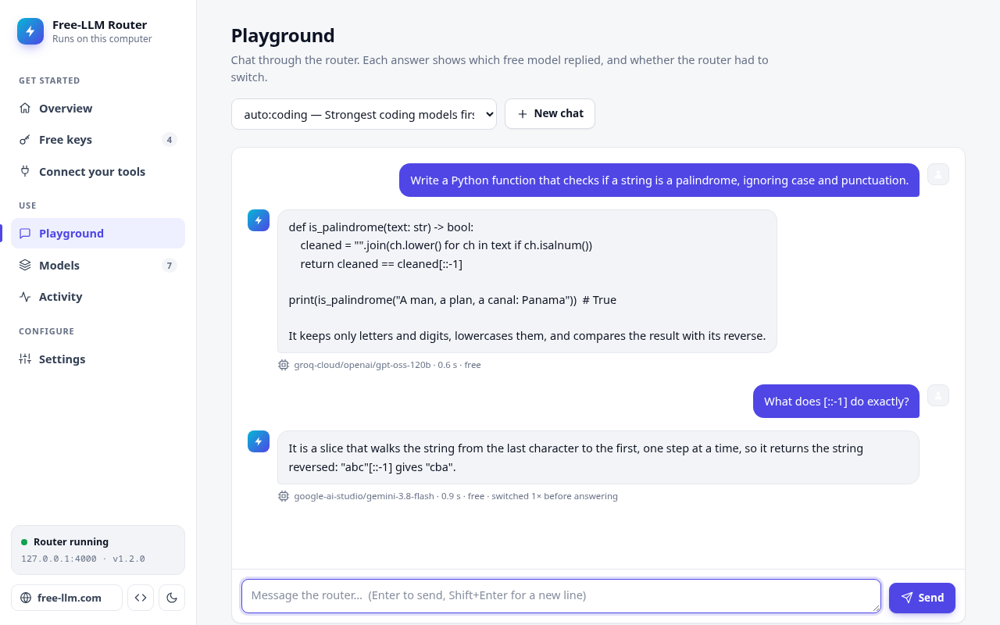

<p align="center">
  <h1 align="center">Free-LLM — 無料 AI・LLM API オープンディレクトリ</h1>
<!--STATS:START-->
  <p align="center"><strong>86 プロバイダーから 450 以上の無料 LLM モデル</strong> — 数秒で無料モデルを見つけ、比較し、設定できます。無制限・プライベートに使えるローカル/セルフホストツールも 9 種類。</p>
<!--STATS:END-->
</p>

<p align="center">
  <a href="https://free-llm.com" target="_blank" rel="noopener"><strong>🌐 free-llm.com で見る</strong></a> —
  <a href="https://free-llm.com/compare" target="_blank" rel="noopener">プロバイダー比較</a> ·
  <a href="https://free-llm.com/submit" target="_blank" rel="noopener">プロバイダーを投稿</a> ·
  <a href="https://free-llm.com/guides" target="_blank" rel="noopener">ガイド</a> ·
  <a href="https://free-llm.com/hall-of-fame" target="_blank" rel="noopener">殿堂</a>
</p>

<p align="center">
  <a href="https://free-llm.com" target="_blank" rel="noopener"></a>
  <a href="LICENSE"></a>
  <a href="https://free-llm.com/submit" target="_blank" rel="noopener"></a>
</p>

<p align="center">
  🌐 <a href="README.md">English</a> · <a href="README.zh-CN.md">简体中文</a> · <a href="README.zh-TW.md">繁體中文</a> · <a href="README.ja.md">日本語</a> · <a href="README.ko.md">한국어</a>
</p>

---

## ⚡ 新機能：Free-LLM Router — すべての無料 API をひとつのアドレスに

**仕組み：** 下のプロバイダーはどれも*小さな*無料枠しかなく、キーも制限もバラバラです。ルーターはそれらを束ねます。アプリ（Claude Code、Codex、Cursor、自作コード…）は OpenAI/Anthropic 互換の**ひとつ**のアドレスに接続するだけ。ルーターは常に稼働中の無料モデルへリクエストを送り、混雑や上限到達時は**即座に**次のモデルへ切り替えます。

**最大の利点：** 小さな無料枠がたくさん集まると、落ちない大きな無料枠のように使えます。プロバイダー一覧は free-llm.com から毎日自動更新され、誰でも無料で使えます。

```bash
npm install -g github:nejib1/Free-LLM   # `free-llm` コマンドをインストール
free-llm                                # ガイド付きセットアップ → http://localhost:4000
free-llm setup claude                   # Claude Code が無料モデルで動作（codex、opencode、aider も対応）
```

<p align="center"><a href="router/README.md"></a></p>

キーなしでお試し可能（ゲストモード）· コーディングエージェントはコマンド 1 つで設定 · OpenAI / Anthropic / Codex Responses / Ollama / MCP API 対応 · 依存パッケージなし · キーは自分の PC に暗号化して保存。

🔒 **100% ローカル・完全プライベート：** ルーターはあなたの PC 上で動作し、API キーが外に出ることはありません（暗号化して保存）。各キーはそのプロバイダーにだけ送信されます。アカウント不要・テレメトリなし・オープンソース。

**→ [仕組みを読む](router/README.md)** · [free-llm.com/router](https://free-llm.com/router)

---

## このプロジェクトの目的

無料の LLM API を探すために、何十ものリリースノートを読み漁ったり、レート制限を比較するためだけに 5 つも別々のプラットフォームに登録したり、どのプロバイダーが今月まだ無料枠を提供しているか推測したりする必要はないはずです。

このリポジトリは **[free-llm.com](https://free-llm.com)** のオンラインディレクトリを基にした、無料で LLM を使えるすべてのプロバイダーを網羅する、構造化されたコミュニティ運営のリファレンスです。

- ✅ **コミュニティ運営** — 実際のユーザーによる投票・投稿・編集提案を、公開前に審査
- ✅ **クレジットカードの透明性** — 各プロバイダーがカード必須か、電話番号認証が必要か、何も不要かを明記
- ✅ **すぐ使えるコード** — [`code-examples/`](code-examples/) に 稼働中の全プロバイダー分の Python / JavaScript / curl サンプル、さらに Claude Code・Cursor・Codex・OpenCode 向けの専用設定も
- ✅ **横並び比較** — [free-llm.com/compare](https://free-llm.com/compare) で 2 つのプロバイダーの制限・モデル・料金を直接比較

---

## 使い方 — 3 ステップ

1. **プロバイダーを選ぶ** — 下記 [Provider Directory](#provider-directory) を参照。初めてなら **Groq** がおすすめ（クレジットカード不要、約 30 RPM / モデルごとに 1 日 1,000 リクエスト、永久無料）。
2. **API キーを取得する** — [Quick Reference](#quick-reference--base-urls--api-keys) の各行から直接キー取得ページへ。ほとんどはメールアドレスだけで登録できます。
3. **コードに組み込む** — 下記表の base URL とモデル ID を [Quick Start](#quick-start--use-any-free-api-in-30-seconds) のサンプルコードにコピーします。

各プロバイダーの詳細・稼働状況・コミュニティの補足情報は、free-llm.com の各プロバイダーページにあります: **free-llm.com/provider/&lt;slug&gt;**（例: [free-llm.com/provider/groq](https://free-llm.com/provider/groq)）。

---

## Quick Start — 30 秒で無料 API を使う

以下のほとんどのプロバイダーは **OpenAI 互換エンドポイント** を提供しています。`baseURL` と `apiKey` を受け付けるツールなら、この 2 つを差し替えるだけで動作します。

### Python (OpenAI SDK)

```python
from openai import OpenAI

client = OpenAI(
    base_url="https://api.groq.com/openai/v1",  # 無料、クレジットカード不要
    api_key="GROQ_API_KEY",                      # console.groq.com/keys で取得
)

response = client.chat.completions.create(
    model="openai/gpt-oss-120b",
    messages=[{"role": "user", "content": "Hello!"}],
)
print(response.choices[0].message.content)
# Groq 無料枠: 約 30 RPM、チャットモデルごとに 1 日 1,000 リクエスト — 個人利用には十分
```

### コーディングアシスタント

有料 API の代わりに、AI コーディングツールを無料バックエンドに接続:

- **Claude Code** — Anthropic API を使うため、Anthropic 互換エンドポイントを持つプロバイダー（OpenRouter、Z.AI、FreeInference、Ollama）か LiteLLM プロキシを使います。[`code-examples/claude-code.md`](code-examples/claude-code.md) 参照
- **Cursor** — Settings → Models → Add Model。[`code-examples/cursor.md`](code-examples/cursor.md) 参照
- **Codex CLI** — `OPENAI_BASE_URL` と `OPENAI_API_KEY` を設定。[`code-examples/codex.md`](code-examples/codex.md) 参照
- **OpenCode** — オープンソースの AI コーディングエージェント。`/connect` または環境変数で複数のプロバイダーに対応。[`code-examples/opencode.md`](code-examples/opencode.md) 参照

他のすべてのプロバイダーのサンプルコードは下記 [Code Examples](#code-examples) と [`code-examples/`](code-examples/) ディレクトリにあります。

---

## Provider Directory

### ⚡ 永久無料枠

期限なく使い続けられる、レート制限付きの無料アクセスです。

<!--TABLE:PERMANENT:START-->
| プロバイダー · 登録条件 | 無料枠・制限 | 主なモデル |
|:---|:---|:---|
| **[Google AI Studio](https://free-llm.com/provider/google-ai-studio)**<br><sub>🟢 カード不要</sub> | ⏱️ Varies by model (per-model limits are now shown only inside AI Studio)<br>📅 Varies by model. Free: Gemini 3.x Flash / Flash-Lite and Gemini 2.5 Pro/Flash (2.5 redirect to…<br>🗓️ 完全無料<br><sub>[詳細 →](https://free-llm.com/provider/google-ai-studio)</sub> | Gemini 3.8 Flash, Gemma 4 26B A4B IT, Gemma 4 31B IT, Gemini 3 Flash Preview |
| **[Mistral (La Plateforme)](https://free-llm.com/provider/mistral-ai)**<br><sub>📱 電話認証</sub> | ⏱️ 1 request/second<br>🗓️ Free | Mistral Small, Mistral Large 4 (Preview), Codestral 2508, Ministral 3 8B |
| **[Cohere](https://free-llm.com/provider/cohere)**<br><sub>🟢 カード不要</sub> | ⏱️ 20 requests/minute<br>📅 1,000 API calls/month (trial key)<br>🗓️ 1,000 API calls/month (trial key, non-commercial) | Command A (111B), Command A Translate, Command A Vision, North Mini Code |
| **[NVIDIA NIM](https://free-llm.com/provider/nvidia-nim)**<br><sub>📱 電話認証</sub> | ⏱️ ~40 RPM (varies per model, not published) | GLM-5.3 Flash, Riva Translate 4B v2, Cosmos Reason 2 8B, Muse Glimmer 30B |
| **[Groq](https://free-llm.com/provider/groq-cloud)**<br><sub>🟢 カード不要</sub> | ⏱️ 30 RPM; 8K TPM on most chat models (varies by model)<br>📅 1,000 requests/day and 200K tokens/day on gpt-oss / Qwen (varies by model)<br>🗓️ Free Forever | GPT-OSS 120B, Qwen3.8 27B, Whisper Large v3, Whisper Large v3 Turbo |
| **[Z.AI (GLM)](https://free-llm.com/provider/z-ai)**<br><sub>✉️ メール登録</sub> | ⏱️ ~1 request/second (Flash models)<br>📅 ~1,000 requests/day (Flash tier)<br>🗓️ Free tier ongoing, subject to change | GLM-4.6V-Flash (vision), GLM-4.5-Flash, GLM-4.7-Flash |
| **[OVH AI Endpoints](https://free-llm.com/provider/ovh-ai)**<br><sub>✉️ メール登録</sub> | ⏱️ 2 RPM per IP per model (anonymous, free); 400 RPM with a key (pay-as-you-go)<br>🗓️ Beta Access | GPT OSS 120B, BGE-M3 (embeddings), Whisper Large v3 Turbo, Qwen2.5 VL 72B Instruct |
| **[Cloudflare Workers AI](https://free-llm.com/provider/cloudflare-workers-ai)**<br><sub>🟢 カード不要</sub> | ⏱️ モデルにより異なる<br>📅 1 日 10,000 neurons<br>🗓️ ~300,000 neurons/month | FLUX.2 Dev (image), Whisper Large v3 Turbo, EuroLLM 9B, Apertus v1.5 8B |
| **[Hetzner Inference API](https://free-llm.com/provider/hetzner-inference)**<br><sub>💳 カード必要</sub> | ⏱️ 10 requests, 4M input / 100K output tokens per 60s (per API key)<br>📅 No daily cap published (free while the API is experimental); a Hetzner account with billing de…<br>🗓️ Free during experimental phase, no billing system yet<br><sub>[詳細 →](https://free-llm.com/provider/hetzner-inference)</sub> | Qwen3.8 27B, Qwen3.6 35B A3B |
| **[Kilo AI Gateway](https://free-llm.com/provider/kilo-gateway)**<br><sub>🟢 カード不要</sub> | ⏱️ 200 requests/hour per IP on free models (anonymous use allowed)<br>📅 Default free models only<br>🗓️ Free plan, no expiry | Nemotron 3.5 Lightning, Nemotron 3 Nano Omni Reasoning, Dots3-Note Preview, Reflection Beam 1.0 |
| **[Nous Portal](https://free-llm.com/provider/nous-portal)**<br><sub>💳 カード必要</sub> | ⏱️ Standard rate limits (figures not published)<br>📅 Free models only (no monthly credit)<br>🗓️ Free tier: $0/month. A GitHub user reported (14 Sep 2026) that a payment method (Stripe, $0 ch…<br><sub>[詳細 →](https://free-llm.com/provider/nous-portal)</sub> | StepFun Step 3.7 Flash, Upstage Solar Mini 4, Qwen4 Max, LongCat 2.5 |
| **[ModelScope](https://free-llm.com/provider/modelscope)**<br><sub>📱 電話認証</sub> | ⏱️ 500 requests/day per model<br>📅 2,000 requests/day total<br>🗓️ Free, no billing | Qwen3.8 27B, Nex N2.5 Pro, LongCat Flash Lite, ERNIE 4.5 300B A47B |
| **[FreeInference](https://free-llm.com/provider/freeinference)**<br><sub>🟢 カード不要</sub> | ⏱️ Not published ("generous quota"; HTTP 429 when rate-limited)<br>📅 No published daily cap | GLM-5.3 Flash, DeepSeek V4 Flash, MiniMax M3, Qwen3.6 35B A3B |
| **[Ollama Cloud](https://free-llm.com/provider/ollama-cloud)**<br><sub>🟢 カード不要</sub> | ⏱️ Pay-as-you-go: 3 concurrent requests; only Beam (beam:cloud) is labelled free<br>📅 No free monthly allowance any more (starter credits removed); other cloud models are billed pe…<br>🗓️ Weekly usage limit resets every 7 days<br><sub>[詳細 →](https://free-llm.com/provider/ollama-cloud)</sub> | Reflection Beam (501B) |
| **[SiliconFlow](https://free-llm.com/provider/siliconflow)**<br><sub>📱 電話認証</sub> | ⏱️ Fixed limits for free models — exact figures require login, verify on cloud.siliconflow.cn/mod…<br>📅 Not fully published — verify on docs.siliconflow.cn<br>🗓️ Free models available after identity verification<br><sub>[詳細 →](https://free-llm.com/provider/siliconflow)</sub> | GLM-Z1 9B, Qwen2.5 7B Instruct, Xing4.0 29B A4B, GLM-4 9B 0414 |
| **[Aion Labs](https://free-llm.com/provider/aion-labs)**<br><sub>🟢 カード不要</sub> | ⏱️ Not published (daily credit allowance)<br>📅 Daily free credit allowance (amount not published by Aion Labs)<br>🗓️ Free, no billing | Aion 2.0, Aion 3.0 Mini, Aion 3.5 Mini |
| **[Api.Airforce](https://free-llm.com/provider/api-airforce)**<br><sub>🟢 カード不要</sub> | ⏱️ 1 RPM<br>📅 1,000 requests/day<br>🗓️ Free plan, $0/month | GPT-OSS 20B, GLM-4.7 Flash, Kimi K2.7 Code, Llama Instant |
| **[Routeway](https://free-llm.com/provider/routeway)**<br><sub>✉️ メール登録</sub> | ⏱️ 5 RPM on :free models<br>📅 200 requests/day<br>🗓️ Starter plan free, shared queue | DeepSeek V4.1 Flash (free), MiniMax M3.1 Flash (free), Muse Glimmer 30B |
| **[OpenTyphoon (Typhoon API)](https://free-llm.com/provider/opentyphoon)**<br><sub>🟢 カード不要</sub> | ⏱️ 5 requests/second, 200 RPM (text models); 20 RPM for OCR<br>📅 No daily cap published | Typhoon 2.5 30B A3B Instruct, Typhoon OCR 1.5 |
| **[SEA-LION API](https://free-llm.com/provider/sea-lion)**<br><sub>✉️ メール登録</sub> | ⏱️ 10 requests/minute per user (increase on request: sealion@aisingapore.org) | Qwen SEA-LION v4.5 27B Instruct, Llama SEA-LION v3.5 70B Reasoning, SEA-Guard (safety), SEA-LION Embedding 600M |
| **[LLM.kiwi](https://free-llm.com/provider/llm-kiwi)**<br><sub>✉️ メール登録</sub> | ⏱️ Baseline rate limits (figures not published) | Auto router, MiniMax M3, Nemotron 3 Ultra, Nemotron 3 Super |
| **[Agnes AI](https://free-llm.com/provider/agnes-ai)**<br><sub>✉️ メール登録</sub> | ⏱️ About 30 RPM per account (video 2 RPM), per third-party listings | Agnes 3.0 Flash, Agnes 2.5 Flash, Agnes Image 2.1 Flash (image) |
| **[AI Horde (OpenAI-compatible front)](https://free-llm.com/provider/ai-horde)**<br><sub>🟢 カード不要</sub> | ⏱️ Queue-based; anonymous requests have the lowest priority, registered users earn kudos for prio…<br>📅 No fixed cap (volunteer capacity)<br><sub>[詳細 →](https://free-llm.com/provider/ai-horde)</sub> | Gemma 4 E4B IT, Qwen3 4B, Llama 3.2 1B Instruct, L3 8B Stheno v3.2 |
| **[Arli AI](https://free-llm.com/provider/arli-ai)**<br><sub>✉️ メール登録</sub> | ⏱️ 1 request at a time; max 12K context tokens<br>📅 Limited trial uses per model (about 5 requests per 2 days, per third-party list) | Qwen3.5 27B Derestricted |
| **[iFlytek Spark Lite](https://free-llm.com/provider/iflytek-spark)**<br><sub>📱 電話認証</sub> | ⏱️ Not published on the HTTP doc<br>📅 Not published (Lite is free) | Spark Lite |
| **[Zhipu BigModel (China)](https://free-llm.com/provider/zhipu-bigmodel)**<br><sub>📱 電話認証</sub> | ⏱️ Low concurrency on free Flash models (GLM-4.7-Flash reported at 1 concurrent request) | GLM-4.7-Flash, GLM-4.5-Flash, GLM-4-Flash-250414, GLM-4.6V-Flash (vision) |
| **[Mixlayer](https://free-llm.com/provider/mixlayer)**<br><sub>✉️ メール登録</sub> | ⏱️ Per-organization, per-model RPM/TPM (values shown in console only) | Qwen3.5 4B (free) |
| **[SenseNova (SenseTime)](https://free-llm.com/provider/sensenova)**<br><sub>📱 電話認証</sub> | 📅 Not published (\"限时放量\" during public beta) | SenseNova 6.8 Flash Lite |
| **[Pollinations.ai](https://free-llm.com/provider/pollinations-ai)**<br><sub>🟢 カード不要</sub> | ⏱️ API key required (anonymous access removed); no card<br>📅 Free usage paid from Quest Pollen earned in the dashboard<br>🗓️ Free, no billing system | GPT-OSS 20B, Mistral Large 3, Kimi K2.6, GLM 5.3 Flash |
| **[LLM7.io](https://free-llm.com/provider/llm7-io)**<br><sub>🟢 カード不要</sub> | ⏱️ 1 req/s, 60/min, 250/hour (free token from dash.llm7.io)<br>📅 100,000 tokens per 24h (free token; may be reduced without notice)<br>🗓️ Free, no billing | Mistral Nemo Instruct 2407, Codestral Latest, GPT OSS 20B |
<!--TABLE:PERMANENT:END-->

### 💰 更新型クレジット

定期的に更新される無料クレジットで、一度きりの失効はありません。

<!--TABLE:RENEWABLE:START-->
| プロバイダー · 登録条件 | 無料枠・制限 | 主なモデル |
|:---|:---|:---|
| **[OpenRouter](https://free-llm.com/provider/openrouter)**<br><sub>🟢 カード不要</sub> | 🎁 50 requests/day (up to 1000 with $10 topup)<br>⏱️ 20 requests/minute | Gemma 4 31B IT, NVIDIA Nemotron 3 Ultra, Recursive Flint v1.0 (free), Nemotron 3.5 Super VL |
| **[Gonka Broker](https://free-llm.com/provider/gonka-broker)**<br><sub>📱 電話認証</sub> | 🎁 Monthly free token grant after SMS verification (does not accumulate)<br>⏱️ Network limits (see docs.gonkabroker.com Limits & Quotas) | GLM-5.3 Flash, DeepSeek V4 Flash 0731, MiniMax M2.7 |
| **[Experiential Labs](https://free-llm.com/provider/experiential-labs)**<br><sub>💳 カード必要</sub> | 🎁 1M input+output tokens/day shared across free core models, reset 00:00 UTC<br>⏱️ 10 RPM and 250K TPM per free core model | GPT-6 Luna, DeepSeek V4.1 Flash 1017, Clef Flash (decision endpoint, free promo) |
| **[Requesty](https://free-llm.com/provider/requesty)**<br><sub>🟢 カード不要</sub> | 🎁 200 requests/day (new orgs) / 1,000/day (paying orgs), shared across free models<br>⏱️ 20 RPM on free models (60 RPM for paying orgs) | Gemma 4 31B IT, Nemotron 3 Nano Omni Reasoning, Nemotron 3 Nano 30B A3B, Mistral Leanstral 1.5 |
| **[Vercel AI Gateway](https://free-llm.com/provider/vercel-ai-gateway)**<br><sub>✉️ メール登録</sub> | 🎁 $5/month<br>⏱️ Lower per-model limits than the paid tier (429 on excess) | Nemotron 3.5 Lightning (free), Llama 3.3 70B, MiniMax M3.1 Flash, GLM-4.7 Flash |
| **[Token Harbor](https://free-llm.com/provider/token-harbor)**<br><sub>✉️ メール登録</sub> | 🎁 Free allowance, resets on a rolling 7-day period<br>⏱️ 60 requests/min and 1,800/hour per account (100/min, 3,000/hour per IP) | DeepSeek V4.1 Flash, MiMo V2.6 Flash, TH-Rudder |
| **[BazaarLink](https://free-llm.com/provider/bazaarlink)**<br><sub>✉️ メール登録</sub> | 🎁 60 weighted units/day (120 with credit), resets 00:00 UTC<br>⏱️ 10 RPM (20 RPM with any credit), 2 concurrent requests | Qwen3.7 Flash, Nemotron 3.5 Lightning (free), DeepSeek V4 Flash 0731 (free), Glyph Cluster (stealth) |
| **[AnyAPI](https://free-llm.com/provider/anyapi)**<br><sub>🟢 カード不要</sub> | 🎁 100K ANY tokens per day, free models only<br>⏱️ Limited API calls on the Free plan (exact RPM not published) | See provider |
| **[Zro (MoonMath)](https://free-llm.com/provider/zro)**<br><sub>✉️ メール登録</sub> | 🎁 Resets every day (Flash models only)<br>⏱️ Daily usage allowance (amount not published) | GLM-5.3 Flash, DeepSeek V4.1 Flash |
| **[Inferbase](https://free-llm.com/provider/inferbase)**<br><sub>🟢 カード不要</sub> | 🎁 $0.50 of managed model usage per day; 5,000 requests per month<br>⏱️ 100 managed requests per day | GPT-OSS 120B, DeepSeek V4 Flash, Qwen3.6 27B, Gemma 4 31B IT |
| **[AIHubMix (free models)](https://free-llm.com/provider/aihubmix)**<br><sub>✉️ メール登録</sub> | 🎁 100 requests/day and 1M tokens/day per account (500 RPD on some, e.g. glm-4.7-flash-free, codi…<br>⏱️ 5 RPM per account on most *-free routes<br><sub>[詳細 →](https://free-llm.com/provider/aihubmix)</sub> | Coding GLM 5.3 (free), Coding GLM 5.3 Flash (free), Coding Kimi K3 (free), Coding MiniMax M3 (free) |
| **[IBM watsonx.ai (Lite plan)](https://free-llm.com/provider/ibm-watsonx)**<br><sub>💳 カード必要</sub> | 🎁 300,000 tokens/month + 20 CUH/month<br>⏱️ About 2 requests/second (Lite) | Granite 4 H Small, Llama 3.3 70B Instruct, Llama 4 Maverick, GPT-OSS 120B |
| **[Bytez](https://free-llm.com/provider/bytez)**<br><sub>✉️ メール登録</sub> | 🎁 $1 free credits, refreshed every 4 weeks<br>⏱️ 1 concurrent request (open models); 10 requests/second (closed models) | See provider |
| **[Moark (Gitee AI)](https://free-llm.com/provider/moark)**<br><sub>📱 電話認証</sub> | 🎁 100 free calls/day per user (free experience access token) | DeepSeek V4 Flash 0731, GLM 5.3 Flash, Qwen3.8 27B |
| **[MegaNova AI](https://free-llm.com/provider/meganova)**<br><sub>🟢 カード不要</sub> | 🎁 Tier 1: 50-500 free-model requests/day (varies by model)<br>⏱️ Tier 1 (free): 20-200 RPM | Manta Pro 1.0, Manta Flash 1.0, Manta Mini 1.0, Mistral Small 3.2 24B |
| **[SimpleLLM](https://free-llm.com/provider/simplellm)**<br><sub>✉️ メール登録</sub> | 🎁 Free-model hourly/daily request and token allowances (values per account, not published)<br>⏱️ Account-specific (read via GET /v1/rate-limit) | Llama 3.1 8B Free, Gemma E4B Free, Mistral 7B (tier free, $0), Kode 14B (tier free, $0) |
| **[Sail Research](https://free-llm.com/provider/sail-research)**<br><sub>💳 カード必要</sub> | 🎁 $5 free credits every month (payment method attached)<br>⏱️ Not published for Free plan (most relaxed on flex window) | Kimi K3, GLM 5.3, GLM 5.3 Flash, DeepSeek V4.1 Flash 1017 |
| **[LLMTR](https://free-llm.com/provider/llmtr)**<br><sub>✉️ メール登録</sub> | 🎁 Per-model daily allowance (e.g. 200K tokens/day on dated previews)<br>⏱️ Not published; lower allowance in an account's first 24h | Nemotron 3 Ultra 550B, Nemotron 3.5 Super VL (free), Qwen3.8 27B (free), GPT-OSS Safeguard 20B |
| **[Kiosapi.id](https://free-llm.com/provider/kiosapi)**<br><sub>✉️ メール登録</sub> | 🎁 50 requests/day per account shared across free models, reset 07:00 WIB<br>⏱️ 5 requests/minute (free models) | GLM 4.7 Flash, Qwen3 30B, Gemma 4 26B, Llama 3.1 8B |
<!--TABLE:RENEWABLE:END-->

### 🎁 一度きりの試用クレジット

登録すると使い切りのクレジットがもらえます。

<!--TABLE:TRIAL:START-->
| プロバイダー · 登録条件 | 無料クレジット | 主なモデル |
|:---|:---|:---|
| **[Replicate](https://free-llm.com/provider/replicate)**<br><sub>✉️ メール登録</sub> | 🎁 Limited free runs on select models<br>⌛ 一度きり | See provider |
| **[Fireworks AI](https://free-llm.com/provider/fireworks-ai)**<br><sub>✉️ メール登録</sub> | 🎁 Free starter credit for new accounts (amount no longer stated by Fireworks; historically $1)<br>⌛ 一度きり | Nemotron 3.5 Lightning 30B A3B, MiniMax M3, GPT-OSS 120B, GLM 5.3 Flash |
| **[Hyperbolic](https://free-llm.com/provider/hyperbolic)**<br><sub>📱 電話認証</sub> | 🎁 $1 after phone verification (Free Tier)<br>⌛ 一度きり | DeepSeek V4 Flash 0731, Qwen3.8 27B, MiMo V2.6 Flash, GLM-5.3 Flash |
| **[Cerebras](https://free-llm.com/provider/cerebras)**<br><sub>💳 カード必要</sub> | 🎁 $5 after adding a verified payment method (expires after 30 days)<br>⌛ 30 日間 | GPT OSS 120B, Qwen 3.8 27B |
| **[Novita AI](https://free-llm.com/provider/novita-ai)**<br><sub>✉️ メール登録</sub> | 🎁 No automatic sign-up credit; $10 per referral (both sides)<br>⌛ 一度きり | GLM 5.3, Kimi K3, DeepSeek V4.1 Flash, Qwen3.8 27B |
| **[Scaleway Generative APIs](https://free-llm.com/provider/scaleway)**<br><sub>✉️ メール登録</sub> | 🎁 1M tokens (+60 min audio transcription), all serverless models<br>⌛ 一度きり | GPT-OSS 120B, Whisper Large v3, Voxtral Small 24B, Holo2 30B A3B |
| **[Qwen (Alibaba)](https://free-llm.com/provider/qwen-alibaba)**<br><sub>✉️ メール登録</sub> | 🎁 ~1M tokens per model, 90 days (Singapore; newer models only since Oct 29, 2026)<br>⌛ One-time per model | Qwen3.8 Flash, Qwen3.7 Plus, Qwen3.8 Max, Qwen3.7 Max |
| **[Upstage](https://free-llm.com/provider/upstage)**<br><sub>✉️ メール登録</sub> | 🎁 $10 sign-up credit (announced by Upstage; not shown on the pricing page, verify)<br>⌛ 3 ヶ月 | See provider |
| **[Friendli AI](https://free-llm.com/provider/friendli-ai)**<br><sub>✉️ メール登録</sub> | 🎁 Trial credits at onboarding (amount not published)<br>⌛ 一度きり | GLM-5.1, Gemma 4 31B, GLM 5.2, GLM 5.3 Flash |
| **[Cerebrium](https://free-llm.com/provider/cerebrium)**<br><sub>✉️ メール登録</sub> | 🎁 No sign-up credit shown on the pricing page (Hobby plan: free platform, compute billed per sec…<br>⌛ 一度きり<br><sub>[詳細 →](https://free-llm.com/provider/cerebrium)</sub> | See provider |
| **[Grokified](https://free-llm.com/provider/grokified)**<br><sub>🟢 カード不要</sub> | 🎁 $5<br>⌛ 一度きり | Grok 4.7, grok-4.6, grok-4.3, grok-build-0.1 |
| **[IteraCompute](https://free-llm.com/provider/iteracompute)**<br><sub>✉️ メール登録</sub> | 🎁 30M tokens/month on Qwen3.8-27B (promotion, no card)<br>⌛ Until Nov 24, 2026 00:00 PT | Qwen3.8 27B |
| **[Dahl Inference](https://free-llm.com/provider/dahl-inference)**<br><sub>✉️ メール登録</sub> | — | GLM-5.3 Flash, MiniMax M2.7, DeepSeek V4 Flash 0731 |
| **[Regolo.ai](https://free-llm.com/provider/regolo-ai)**<br><sub>🟢 カード不要</sub> | 🎁 30-day trial, 1M tokens/day, no card<br>⌛ 30 日間 | GPT-OSS 120B, Qwen3.8 27B, Gemma 4 31B, GLM-5.2 |
| **[GonkaRouter](https://free-llm.com/provider/gonkarouter)**<br><sub>🟢 カード不要</sub> | 🎁 1M free tokens for new users<br>⌛ 一度きり | GLM-5.3 Flash, DeepSeek V4 Flash, MiniMax M2.7 |
| **[NovAI](https://free-llm.com/provider/novai)**<br><sub>🟢 カード不要</sub> | 🎁 $2 welcome credit, no card<br>⌛ 一度きり | GLM-4.7 Flash, GLM-4.6V Flash, GLM-4.1V Thinking Flash |
| **[Vectoree](https://free-llm.com/provider/vectoree)**<br><sub>🟢 カード不要</sub> | 🎁 $5 welcome credit after CLI login<br>⌛ 一度きり | Vectoree Auto (router) |
| **[Sarvam AI](https://free-llm.com/provider/sarvam-ai)**<br><sub>📱 電話認証</sub> | 🎁 INR 100 free credits on signup<br>⌛ One-time; credits do not expire (per third-party list) | Sarvam 105B, Sarvam 105B Conversations |
| **[HPC-AI Model APIs](https://free-llm.com/provider/hpc-ai)**<br><sub>✉️ メール登録</sub> | 🎁 $2 free voucher on signup ($4 with an invite code, per third-party list)<br>⌛ 一度きり | Kimi K2.7 Code |
| **[VLM Run Gateway](https://free-llm.com/provider/vlm-run)**<br><sub>🟢 カード不要</sub> | 🎁 100 free credits on sign-up (~$1, at $0.01/credit)<br>⌛ One-time, then pay-as-you-go | Qwen3.8 27B, Gemma 4 26B A4B IT, Qwen3.5 0.8B, DiffusionGemma 26B A4B |
| **[Tencent Cloud TokenHub](https://free-llm.com/provider/tencent-tokenhub)**<br><sub>💳 カード必要</sub> | 🎁 1M free tokens per language model, once per account per model<br>⌛ 90 days after claim (intl promo page; docs say 1 year); campaign ends 2026-12-31" - DeepSeek-V…<br><sub>[詳細 →](https://free-llm.com/provider/tencent-tokenhub)</sub> | See provider |
| **[Google Vertex AI express mode (Gemini Enterprise Agent Platform)](https://free-llm.com/provider/vertex-ai-express)**<br><sub>✉️ メール登録</sub> | 🎁 Free-tier quota access, no billing account<br>⌛ Up to 90 days for new Google Cloud users | Gemini 3.1 Pro Preview, Gemini 3 Flash Preview, Gemini 2.5 Pro, Gemini 2.5 Flash |
| **[Jina AI (Embeddings / Reader API)](https://free-llm.com/provider/jina-ai)**<br><sub>🟢 カード不要</sub> | 🎁 Free tokens on an auto-generated key (amount not stated on page)<br>⌛ Keys do not expire | Jina Embeddings v5 Text Small, Jina Embeddings v5 Text Nano, Jina Embeddings v5 Omni Small, Jina Embeddings v3 |
| **[Voyage AI (embeddings & rerankers)](https://free-llm.com/provider/voyage-ai)**<br><sub>✉️ メール登録</sub> | 🎁 First 200M tokens free per model (voyage-4 family, rerank-2.5); 50M on domain models<br>⌛ One-time per account per model | Voyage 4 Large, Voyage 4, Voyage 4 Lite, Voyage Code 3 |
| **[Inception Labs](https://free-llm.com/provider/inception-labs)**<br><sub>🟢 カード不要</sub> | 🎁 100M tokens<br>⌛ One-time (new accounts) | Mercury 3, Mercury 2.5, Mercury 2 |
<!--TABLE:TRIAL:END-->

### 🖥️ ローカル / セルフホスト（無制限・プライベート・永久無料）

| ツール | 種類 | 特徴 |
|:---|:---|:---|
| [Ollama](https://ollama.com/) | CLI + API | 100 以上のモデル、GPU アクセラレーション、OpenAI 互換エンドポイント |
| [LM Studio](https://lmstudio.ai/) | デスクトップ GUI | 任意の GGUF モデル、モデルブラウザ内蔵、オフライン利用可 |
| [llama.cpp](https://github.com/ggml-org/llama.cpp) | C/C++ エンジン | 任意の GGUF を実行、依存関係が最小限 |
| [GPT4All](https://gpt4all.io/) | デスクトップアプリ | CPU のみで動作、GPU 不要、オープンソース（2025 年 2 月以降リリースなし） |
| [Jan.ai](https://jan.ai/) | デスクトップアプリ | プライバシー重視、100% オフラインの ChatGPT 代替 |
| [KoboldCpp](https://github.com/LostRuins/koboldcpp) | 単一実行ファイル | 創作・ロールプレイ向けに最適化、GGUF 対応 |
| [llamafile](https://github.com/mozilla-ai/llamafile) | 単一実行ファイル | クロスプラットフォーム、llama.cpp + Cosmopolitan Libc |
| [Text Generation WebUI](https://github.com/oobabooga/textgen) | Gradio UI | 高度にカスタマイズ可能、上級者向けローカル実験に |
| [BentoML](https://www.bentoml.com/) | 推論プラットフォーム | 任意の AI/ML モデルをどこにでもデプロイ、本番運用グレード |

---

## Quick Reference — Base URL と API キー

<!--TABLE:QUICKREF:START-->
| プロバイダー · 登録条件 · API キー | OpenAI 互換 Base URL |
|:---|:---|
| **[OpenRouter](https://free-llm.com/provider/openrouter)**<br><sub>🟢 カード不要 · [🔑&nbsp;キー](https://openrouter.ai/)</sub> | `https://openrouter.ai/api/v1` |
| **[Google AI Studio](https://free-llm.com/provider/google-ai-studio)**<br><sub>🟢 カード不要 · [🔑&nbsp;キー](https://aistudio.google.com/)</sub> | `https://generativelanguage.googleapis.com/v1beta/openai` |
| **[Cohere](https://free-llm.com/provider/cohere)**<br><sub>🟢 カード不要 · [🔑&nbsp;キー](https://cohere.com/)</sub> | `https://api.cohere.ai/compatibility/v1` |
| **[Groq](https://free-llm.com/provider/groq-cloud)**<br><sub>🟢 カード不要 · [🔑&nbsp;キー](https://console.groq.com/)</sub> | `https://api.groq.com/openai/v1` |
| **[Cloudflare Workers AI](https://free-llm.com/provider/cloudflare-workers-ai)**<br><sub>🟢 カード不要 · [🔑&nbsp;キー](https://dash.cloudflare.com/)</sub> | `https://api.cloudflare.com/client/v4/accounts/{account_id}/ai/v1` |
| **[Kilo AI Gateway](https://free-llm.com/provider/kilo-gateway)**<br><sub>🟢 カード不要 · [🔑&nbsp;キー](https://kilo.ai/gateway)</sub> | `https://ai-gateway.kilo.ai/api/v1` |
| **[FreeInference](https://free-llm.com/provider/freeinference)**<br><sub>🟢 カード不要 · [🔑&nbsp;キー](https://freeinference.org)</sub> | `https://freeinference.org/v1` |
| **[Ollama Cloud](https://free-llm.com/provider/ollama-cloud)**<br><sub>🟢 カード不要 · [🔑&nbsp;キー](https://ollama.com/cloud)</sub> | `https://ollama.com/v1` |
| **[Requesty](https://free-llm.com/provider/requesty)**<br><sub>🟢 カード不要 · [🔑&nbsp;キー](https://requesty.ai/)</sub> | `https://router.requesty.ai/v1` |
| **[Aion Labs](https://free-llm.com/provider/aion-labs)**<br><sub>🟢 カード不要 · [🔑&nbsp;キー](https://www.aionlabs.ai/pricing/)</sub> | `https://api.aionlabs.ai/v1` |
| **[Grokified](https://free-llm.com/provider/grokified)**<br><sub>🟢 カード不要 · [🔑&nbsp;キー](https://grokified.com)</sub> | `https://api.grokified.com/v1` |
| **[Api.Airforce](https://free-llm.com/provider/api-airforce)**<br><sub>🟢 カード不要 · [🔑&nbsp;キー](https://api.airforce/)</sub> | `https://api.airforce/v1` |
| **[AnyAPI](https://free-llm.com/provider/anyapi)**<br><sub>🟢 カード不要 · [🔑&nbsp;キー](https://anyapi.ai)</sub> | `https://api.anyapi.ai/v1` |
| **[Inferbase](https://free-llm.com/provider/inferbase)**<br><sub>🟢 カード不要 · [🔑&nbsp;キー](https://inferbase.ai)</sub> | `https://api.inferbase.ai/v1` |
| **[OpenTyphoon (Typhoon API)](https://free-llm.com/provider/opentyphoon)**<br><sub>🟢 カード不要 · [🔑&nbsp;キー](https://opentyphoon.ai)</sub> | `https://api.opentyphoon.ai/v1` |
| **[Regolo.ai](https://free-llm.com/provider/regolo-ai)**<br><sub>🟢 カード不要 · [🔑&nbsp;キー](https://regolo.ai)</sub> | `https://api.regolo.ai/v1` |
| **[GonkaRouter](https://free-llm.com/provider/gonkarouter)**<br><sub>🟢 カード不要 · [🔑&nbsp;キー](https://gonkarouter.io)</sub> | `https://api.gonkarouter.io/v1` |
| **[NovAI](https://free-llm.com/provider/novai)**<br><sub>🟢 カード不要 · [🔑&nbsp;キー](https://aiapi-pro.com)</sub> | `https://aiapi-pro.com/v1` |
| **[Vectoree](https://free-llm.com/provider/vectoree)**<br><sub>🟢 カード不要 · [🔑&nbsp;キー](https://vectoree.ai)</sub> | `https://vectoree.ai/api/v1` |
| **[AI Horde (OpenAI-compatible front)](https://free-llm.com/provider/ai-horde)**<br><sub>🟢 カード不要 · [🔑&nbsp;キー](https://aihorde.net)</sub> | `https://oai.aihorde.net/v1` |
| **[VLM Run Gateway](https://free-llm.com/provider/vlm-run)**<br><sub>🟢 カード不要 · [🔑&nbsp;キー](https://docs.vlm.run/gateway/rate-limits)</sub> | `https://gateway.vlm.run/v1/openai` |
| **[MegaNova AI](https://free-llm.com/provider/meganova)**<br><sub>🟢 カード不要 · [🔑&nbsp;キー](https://docs.meganova.ai/tiers)</sub> | `https://api.meganova.ai/v1` |
| **[Jina AI (Embeddings / Reader API)](https://free-llm.com/provider/jina-ai)**<br><sub>🟢 カード不要 · [🔑&nbsp;キー](https://jina.ai/embeddings/)</sub> | `https://api.jina.ai/v1` |
| **[Pollinations.ai](https://free-llm.com/provider/pollinations-ai)**<br><sub>🟢 カード不要 · [🔑&nbsp;キー](https://pollinations.ai)</sub> | `https://gen.pollinations.ai/v1` |
| **[Inception Labs](https://free-llm.com/provider/inception-labs)**<br><sub>🟢 カード不要 · [🔑&nbsp;キー](https://www.inceptionlabs.ai/)</sub> | `https://api.inceptionlabs.ai/v1` |
| **[LLM7.io](https://free-llm.com/provider/llm7-io)**<br><sub>🟢 カード不要 · [🔑&nbsp;キー](https://llm7.io)</sub> | `https://api.llm7.io/v1` |
| **[Replicate](https://free-llm.com/provider/replicate)**<br><sub>✉️ メール登録 · [🔑&nbsp;キー](https://replicate.com/)</sub> | <sub>独自 API のみ — [設定ガイド](https://free-llm.com/provider/replicate)</sub> |
| **[Fireworks AI](https://free-llm.com/provider/fireworks-ai)**<br><sub>✉️ メール登録 · [🔑&nbsp;キー](https://fireworks.ai/)</sub> | `https://api.fireworks.ai/inference/v1` |
| **[Novita AI](https://free-llm.com/provider/novita-ai)**<br><sub>✉️ メール登録 · [🔑&nbsp;キー](https://novita.ai/)</sub> | `https://api.novita.ai/v3/openai` |
| **[Scaleway Generative APIs](https://free-llm.com/provider/scaleway)**<br><sub>✉️ メール登録 · [🔑&nbsp;キー](https://console.scaleway.com/generative-api/models)</sub> | `https://api.scaleway.ai/v1` |
| **[Qwen (Alibaba)](https://free-llm.com/provider/qwen-alibaba)**<br><sub>✉️ メール登録 · [🔑&nbsp;キー](https://bailian.console.alibabacloud.com/)</sub> | `https://dashscope-intl.aliyuncs.com/compatible-mode/v1` |
| **[Upstage](https://free-llm.com/provider/upstage)**<br><sub>✉️ メール登録 · [🔑&nbsp;キー](https://console.upstage.ai/)</sub> | `https://api.upstage.ai/v1` |
| **[Z.AI (GLM)](https://free-llm.com/provider/z-ai)**<br><sub>✉️ メール登録 · [🔑&nbsp;キー](https://z.ai/)</sub> | `https://api.z.ai/api/paas/v4` |
| **[OVH AI Endpoints](https://free-llm.com/provider/ovh-ai)**<br><sub>✉️ メール登録 · [🔑&nbsp;キー](https://endpoints.ai.cloud.ovh.net/)</sub> | `https://oai.endpoints.kepler.ai.cloud.ovh.net/v1` |
| **[Friendli AI](https://free-llm.com/provider/friendli-ai)**<br><sub>✉️ メール登録 · [🔑&nbsp;キー](https://friendli.ai/)</sub> | `https://inference.friendli.ai/v1` |
| **[Cerebrium](https://free-llm.com/provider/cerebrium)**<br><sub>✉️ メール登録 · [🔑&nbsp;キー](https://www.cerebrium.ai/)</sub> | <sub>独自 API のみ — [設定ガイド](https://free-llm.com/provider/cerebrium)</sub> |
| **[Vercel AI Gateway](https://free-llm.com/provider/vercel-ai-gateway)**<br><sub>✉️ メール登録 · [🔑&nbsp;キー](https://vercel.com/ai-gateway)</sub> | `https://ai-gateway.vercel.sh/v1` |
| **[Routeway](https://free-llm.com/provider/routeway)**<br><sub>✉️ メール登録 · [🔑&nbsp;キー](https://routeway.ai/)</sub> | `https://api.routeway.ai/v1` |
| **[Token Harbor](https://free-llm.com/provider/token-harbor)**<br><sub>✉️ メール登録 · [🔑&nbsp;キー](https://tokenharbor.ai)</sub> | `https://tokenharbor.ai/v1` |
| **[IteraCompute](https://free-llm.com/provider/iteracompute)**<br><sub>✉️ メール登録 · [🔑&nbsp;キー](https://iteracompute.com/free/)</sub> | `https://api.iteracompute.com/v1` |
| **[BazaarLink](https://free-llm.com/provider/bazaarlink)**<br><sub>✉️ メール登録 · [🔑&nbsp;キー](https://bazaarlink.ai/free)</sub> | `https://api.bazaarlink.ai/v1` |
| **[Dahl Inference](https://free-llm.com/provider/dahl-inference)**<br><sub>✉️ メール登録 · [🔑&nbsp;キー](https://inference.dahl.global/)</sub> | `https://inference.dahl.global/v1` |
| **[Zro (MoonMath)](https://free-llm.com/provider/zro)**<br><sub>✉️ メール登録 · [🔑&nbsp;キー](https://zro.moonmath.ai)</sub> | `https://zro.moonmath.ai/v1` |
| **[SEA-LION API](https://free-llm.com/provider/sea-lion)**<br><sub>✉️ メール登録 · [🔑&nbsp;キー](https://docs.sea-lion.ai/guides/inferencing/api)</sub> | `https://api.sea-lion.ai/v1` |
| **[AIHubMix (free models)](https://free-llm.com/provider/aihubmix)**<br><sub>✉️ メール登録 · [🔑&nbsp;キー](https://aihubmix.com)</sub> | `https://aihubmix.com/v1` |
| **[LLM.kiwi](https://free-llm.com/provider/llm-kiwi)**<br><sub>✉️ メール登録 · [🔑&nbsp;キー](https://llm.kiwi/pricing)</sub> | `https://api.llm.kiwi/v1` |
| **[Agnes AI](https://free-llm.com/provider/agnes-ai)**<br><sub>✉️ メール登録 · [🔑&nbsp;キー](https://agnes-ai.com)</sub> | `https://apihub.agnes-ai.com/v1` |
| **[Arli AI](https://free-llm.com/provider/arli-ai)**<br><sub>✉️ メール登録 · [🔑&nbsp;キー](https://www.arliai.com/pricing)</sub> | `https://api.arliai.com/v1` |
| **[HPC-AI Model APIs](https://free-llm.com/provider/hpc-ai)**<br><sub>✉️ メール登録 · [🔑&nbsp;キー](https://www.hpc-ai.com/model-apis)</sub> | `https://api.hpc-ai.com/inference/v1` |
| **[Bytez](https://free-llm.com/provider/bytez)**<br><sub>✉️ メール登録 · [🔑&nbsp;キー](https://docs.bytez.com/model-api/docs/billing)</sub> | `https://api.bytez.com/models/v2/openai/v1` |
| **[Mixlayer](https://free-llm.com/provider/mixlayer)**<br><sub>✉️ メール登録 · [🔑&nbsp;キー](https://docs.mixlayer.com/credits-and-limits)</sub> | `https://models.mixlayer.ai/v1` |
| **[SimpleLLM](https://free-llm.com/provider/simplellm)**<br><sub>✉️ メール登録 · [🔑&nbsp;キー](https://simplellm.eu/docs/)</sub> | `https://api.simplellm.eu/v1` |
| **[Google Vertex AI express mode (Gemini Enterprise Agent Platform)](https://free-llm.com/provider/vertex-ai-express)**<br><sub>✉️ メール登録 · [🔑&nbsp;キー](https://docs.cloud.google.com/vertex-ai/generative-ai/docs/start/express-mode/overview)</sub> | <sub>独自 API のみ — [設定ガイド](https://free-llm.com/provider/vertex-ai-express)</sub> |
| **[Voyage AI (embeddings & rerankers)](https://free-llm.com/provider/voyage-ai)**<br><sub>✉️ メール登録 · [🔑&nbsp;キー](https://docs.voyageai.com/docs/pricing)</sub> | `https://api.voyageai.com/v1` |
| **[LLMTR](https://free-llm.com/provider/llmtr)**<br><sub>✉️ メール登録 · [🔑&nbsp;キー](https://llmtr.com/en/terms)</sub> | `https://llmtr.com/v1` |
| **[Kiosapi.id](https://free-llm.com/provider/kiosapi)**<br><sub>✉️ メール登録 · [🔑&nbsp;キー](https://kiosapi.id/pricing)</sub> | `https://api.kiosapi.id/v1` |
| **[Mistral (La Plateforme)](https://free-llm.com/provider/mistral-ai)**<br><sub>📱 電話認証 · [🔑&nbsp;キー](https://console.mistral.ai/)</sub> | `https://api.mistral.ai/v1` |
| **[NVIDIA NIM](https://free-llm.com/provider/nvidia-nim)**<br><sub>📱 電話認証 · [🔑&nbsp;キー](https://build.nvidia.com/explore/discover)</sub> | `https://integrate.api.nvidia.com/v1` |
| **[Hyperbolic](https://free-llm.com/provider/hyperbolic)**<br><sub>📱 電話認証 · [🔑&nbsp;キー](https://app.hyperbolic.xyz/)</sub> | `https://api.hyperbolic.ai/inference/v1` |
| **[ModelScope](https://free-llm.com/provider/modelscope)**<br><sub>📱 電話認証 · [🔑&nbsp;キー](https://modelscope.cn)</sub> | `https://api-inference.modelscope.cn/v1` |
| **[Gonka Broker](https://free-llm.com/provider/gonka-broker)**<br><sub>📱 電話認証 · [🔑&nbsp;キー](https://gonkabroker.com)</sub> | `https://proxy.gonkabroker.com/v1` |
| **[SiliconFlow](https://free-llm.com/provider/siliconflow)**<br><sub>📱 電話認証 · [🔑&nbsp;キー](https://cloud.siliconflow.cn/models)</sub> | `https://api.siliconflow.cn/v1` |
| **[Sarvam AI](https://free-llm.com/provider/sarvam-ai)**<br><sub>📱 電話認証 · [🔑&nbsp;キー](https://www.sarvam.ai/api-pricing)</sub> | `https://api.sarvam.ai/v1` |
| **[iFlytek Spark Lite](https://free-llm.com/provider/iflytek-spark)**<br><sub>📱 電話認証 · [🔑&nbsp;キー](https://www.xfyun.cn/doc/spark/HTTP调用文档.html)</sub> | `https://spark-api-open.xf-yun.com/v1` |
| **[Zhipu BigModel (China)](https://free-llm.com/provider/zhipu-bigmodel)**<br><sub>📱 電話認証 · [🔑&nbsp;キー](https://docs.bigmodel.cn/cn/guide/start/model-overview)</sub> | `https://open.bigmodel.cn/api/paas/v4` |
| **[Moark (Gitee AI)](https://free-llm.com/provider/moark)**<br><sub>📱 電話認証 · [🔑&nbsp;キー](https://moark.com/docs/FAQ)</sub> | `https://api.moark.com/v1` |
| **[SenseNova (SenseTime)](https://free-llm.com/provider/sensenova)**<br><sub>📱 電話認証 · [🔑&nbsp;キー](https://www.sensenova.cn/token-plan)</sub> | `https://token.sensenova.cn/v1` |
| **[Cerebras](https://free-llm.com/provider/cerebras)**<br><sub>💳 カード必要 · [🔑&nbsp;キー](https://cerebras.ai/inference)</sub> | `https://api.cerebras.ai/v1` |
| **[Hetzner Inference API](https://free-llm.com/provider/hetzner-inference)**<br><sub>💳 カード必要 · [🔑&nbsp;キー](https://experiments.hetzner.com/inference)</sub> | `https://inference.hetzner.com/api/v1` |
| **[Nous Portal](https://free-llm.com/provider/nous-portal)**<br><sub>💳 カード必要 · [🔑&nbsp;キー](https://portal.nousresearch.com)</sub> | `https://inference-api.nousresearch.com/v1` |
| **[Experiential Labs](https://free-llm.com/provider/experiential-labs)**<br><sub>💳 カード必要 · [🔑&nbsp;キー](https://www.experientiallabs.ai/pricing)</sub> | `https://api.experientiallabs.ai/v1` |
| **[Tencent Cloud TokenHub](https://free-llm.com/provider/tencent-tokenhub)**<br><sub>💳 カード必要 · [🔑&nbsp;キー](https://www.tencentcloud.com/act/pro/tokenhub)</sub> | `https://tokenhub-intl.tencentmaas.com/v1` |
| **[IBM watsonx.ai (Lite plan)](https://free-llm.com/provider/ibm-watsonx)**<br><sub>💳 カード必要 · [🔑&nbsp;キー](https://www.ibm.com/products/watsonx-ai/pricing)</sub> | <sub>独自 API のみ — [設定ガイド](https://free-llm.com/provider/ibm-watsonx)</sub> |
| **[Sail Research](https://free-llm.com/provider/sail-research)**<br><sub>💳 カード必要 · [🔑&nbsp;キー](https://docs.sailresearch.com/pricing)</sub> | `https://api.sailresearch.com/v1` |
<!--TABLE:QUICKREF:END-->

---

## ガイド・チュートリアル

[free-llm.com/guides](https://free-llm.com/guides/) で公開中:

- **2026 年版・最高の無料 LLM API** — 主要な選択肢を横並びで比較
- **Gemini vs ChatGPT（無料プラン）** — $0 で実際に何ができるか
- **OpenRouter の使い方** — コード付きセットアップ手順
- **OpenRouter の代替サービス** — 他に試す価値のあるアグリゲーター
- **Ollama でローカル LLM を動かす** — 5 分で始める
- **無料 LLM API 完全ガイド** — 最も詳しい徹底解説
- **コーディング向け無料 LLM** — 無料のコーディングモデルと Claude Code / Codex / Cursor の設定
- **無料の OpenRouter 代替** — 無料枠がより大きいゲートウェイと API
- **無料 LLM フォールバック構成** — 複数プロバイダーをつないでレート制限を回避
- **月次レポート: 2026 年 11 月** — 新しい無料プロバイダー、終了したサービス、モデルの変更

---

## コミュニティ機能

Free-LLM は**コミュニティ主導**のプロジェクトです。[free-llm.com](https://free-llm.com) では以下が可能です:

- **投票** で最も役立つプロバイダーを浮き彫りにする
- **投稿** で新しいプロバイダーやモデルを追加提案
- **編集提案** で既存のプロバイダー情報を更新提案（管理者が審査）
- **報告** で無料から有料に変わったモデルを知らせる
- [殿堂](https://free-llm.com/hall-of-fame) で評価される

データは本リポジトリにも同期されます。

---

## Code Examples

[`code-examples/`](code-examples/) ディレクトリには、すぐ実行できる Python・JavaScript・curl のサンプルがあります。API キーを追加するだけです。

**コーディングアシスタント別:** [Claude Code](code-examples/claude-code.md) · [Cursor](code-examples/cursor.md) · [Codex CLI](code-examples/codex.md) · [OpenCode](code-examples/opencode.md)

<!--CODEEX:PROVIDERS:START-->
**プロバイダー別（74 件）:** [Agnes AI](code-examples/agnes-ai) · [AI Horde (OpenAI-compatible front)](code-examples/ai-horde) · [AIHubMix (free models)](code-examples/aihubmix) · [Aion Labs](code-examples/aion-labs) · [AnyAPI](code-examples/anyapi) · [Api.Airforce](code-examples/api-airforce) · [Arli AI](code-examples/arli-ai) · [BazaarLink](code-examples/bazaarlink) · [Bytez](code-examples/bytez) · [Cerebras](code-examples/cerebras) · [Cerebrium](code-examples/cerebrium) · [Cloudflare Workers AI](code-examples/cloudflare-workers-ai) · [Cohere](code-examples/cohere) · [Dahl Inference](code-examples/dahl-inference) · [Experiential Labs](code-examples/experiential-labs) · [Fireworks AI](code-examples/fireworks-ai) · [FreeInference](code-examples/freeinference) · [Friendli AI](code-examples/friendli-ai) · [Gonka Broker](code-examples/gonka-broker) · [GonkaRouter](code-examples/gonkarouter) · [Google AI Studio](code-examples/google-ai-studio) · [Google Vertex AI express mode (Gemini Enterprise Agent Platform)](code-examples/vertex-ai-express) · [Grokified](code-examples/grokified) · [Groq](code-examples/groq-cloud) · [Hetzner Inference API](code-examples/hetzner-inference) · [HPC-AI Model APIs](code-examples/hpc-ai) · [Hyperbolic](code-examples/hyperbolic) · [IBM watsonx.ai (Lite plan)](code-examples/ibm-watsonx) · [iFlytek Spark Lite](code-examples/iflytek-spark) · [Inception Labs](code-examples/inception-labs) · [Inferbase](code-examples/inferbase) · [IteraCompute](code-examples/iteracompute) · [Jina AI (Embeddings / Reader API)](code-examples/jina-ai) · [Kilo AI Gateway](code-examples/kilo-gateway) · [Kiosapi.id](code-examples/kiosapi) · [LLM.kiwi](code-examples/llm-kiwi) · [LLM7.io](code-examples/llm7-io) · [LLMTR](code-examples/llmtr) · [MegaNova AI](code-examples/meganova) · [Mistral (La Plateforme)](code-examples/mistral-ai) · [Mixlayer](code-examples/mixlayer) · [Moark (Gitee AI)](code-examples/moark) · [ModelScope](code-examples/modelscope) · [Nous Portal](code-examples/nous-portal) · [NovAI](code-examples/novai) · [Novita AI](code-examples/novita-ai) · [NVIDIA NIM](code-examples/nvidia-nim) · [Ollama Cloud](code-examples/ollama-cloud) · [OpenRouter](code-examples/openrouter) · [OpenTyphoon (Typhoon API)](code-examples/opentyphoon) · [OVH AI Endpoints](code-examples/ovh-ai) · [Pollinations.ai](code-examples/pollinations-ai) · [Qwen (Alibaba)](code-examples/qwen-alibaba) · [Regolo.ai](code-examples/regolo-ai) · [Replicate](code-examples/replicate) · [Requesty](code-examples/requesty) · [Routeway](code-examples/routeway) · [Sail Research](code-examples/sail-research) · [Sarvam AI](code-examples/sarvam-ai) · [Scaleway Generative APIs](code-examples/scaleway) · [SEA-LION API](code-examples/sea-lion) · [SenseNova (SenseTime)](code-examples/sensenova) · [SiliconFlow](code-examples/siliconflow) · [SimpleLLM](code-examples/simplellm) · [Tencent Cloud TokenHub](code-examples/tencent-tokenhub) · [Token Harbor](code-examples/token-harbor) · [Upstage](code-examples/upstage) · [Vectoree](code-examples/vectoree) · [Vercel AI Gateway](code-examples/vercel-ai-gateway) · [VLM Run Gateway](code-examples/vlm-run) · [Voyage AI (embeddings & rerankers)](code-examples/voyage-ai) · [Z.AI (GLM)](code-examples/z-ai) · [Zhipu BigModel (China)](code-examples/zhipu-bigmodel) · [Zro (MoonMath)](code-examples/zro)
<!--CODEEX:PROVIDERS:END-->

**ローカル / セルフホスト:** [BentoML](code-examples/bentoml) · [GPT4All](code-examples/gpt4all) · [Jan.ai](code-examples/jan-ai) · [KoboldCpp](code-examples/koboldcpp) · [llama.cpp](code-examples/llama-cpp) · [llamafile](code-examples/llamafile) · [LM Studio](code-examples/lm-studio) · [Ollama](code-examples/ollama) · [Text Gen WebUI](code-examples/text-generation-webui)

---

## リポジトリ構成

```
Free-LLM/
├── README.md                 ← このファイル（英語）
├── README.zh-CN.md            ← 简体中文
├── README.zh-TW.md            ← 繁體中文
├── README.ja.md               ← 日本語
├── README.ko.md                ← 한국어
├── CONTRIBUTING.md            ← 貢献ガイドライン
├── code-examples/             ← すぐ使えるサンプル（プロバイダー別 + ツール別）
├── .github/                   ← Issue / PR テンプレート
└── LICENSE                    ← MIT
```

---

## Contributing（貢献方法）

詳しくは [CONTRIBUTING.md](CONTRIBUTING.md) を参照してください。要約:

1. **プロバイダーを追加** — サイトの [投稿フォーム](https://free-llm.com/submit) を使うか、このリポジトリで [issue](https://github.com/nejib1/Free-LLM/issues/new/choose) / PR を作成
2. **誤ったデータを修正** — レート制限は変わり、プロバイダーは有料化・終了することもあります。PR 歓迎です
3. **コードサンプルを追加** — 未対応のツール（コーディングアシスタント、チャット UI、SDK）向けの動作する設定があれば [`code-examples/`](code-examples/) に追加してください
4. **投票・議論に参加** — [free-llm.com](https://free-llm.com) でコミュニティの選択を助けましょう

### 掲載基準

以下を満たすプロバイダーを掲載します:
1. **本当の無料枠**を明示的に提供していること（無料の選択肢がない有料トライアルは対象外）— 分類方法は [Provider Directory](#provider-directory) を参照
2. API が**一般公開**されていること（ウェイトリスト、クローズドベータ、リバースエンジニアリング不要）
3. 試用クレジットの場合は明示し、恒久的な無料枠の有無を明記すること
4. プロバイダー自身のサービスであること: 他社モデルのキーを転売・共有するサービス（「無料の Claude/GPT」キープール）は掲載しません

---

## Links

- 🌐 **公式サイト**: [free-llm.com](https://free-llm.com) — ディレクトリ、投票、投稿
- 🆚 **プロバイダー比較**: [free-llm.com/compare](https://free-llm.com/compare)
- 📚 **ガイド**: [free-llm.com/guides](https://free-llm.com/guides/)
- 🏆 **殿堂**: [free-llm.com/hall-of-fame](https://free-llm.com/hall-of-fame)
- 🧩 **JSON catalog**: [free-llm.com/catalog.json](https://free-llm.com/catalog.json)
- ➕ **プロバイダーを投稿**: [free-llm.com/submit](https://free-llm.com/submit)

## Star History

[](https://star-history.com/#nejib1/Free-LLM&Date)

---

## License

MIT — 詳細は [LICENSE](LICENSE) を参照してください。

---

<p align="center"><sub>Data synced automatically from the live directory — last updated: <!--LASTSYNC:START-->2026-11-20<!--LASTSYNC:END--></sub></p>
